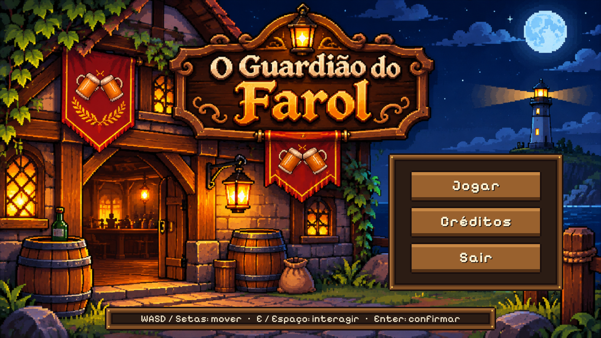
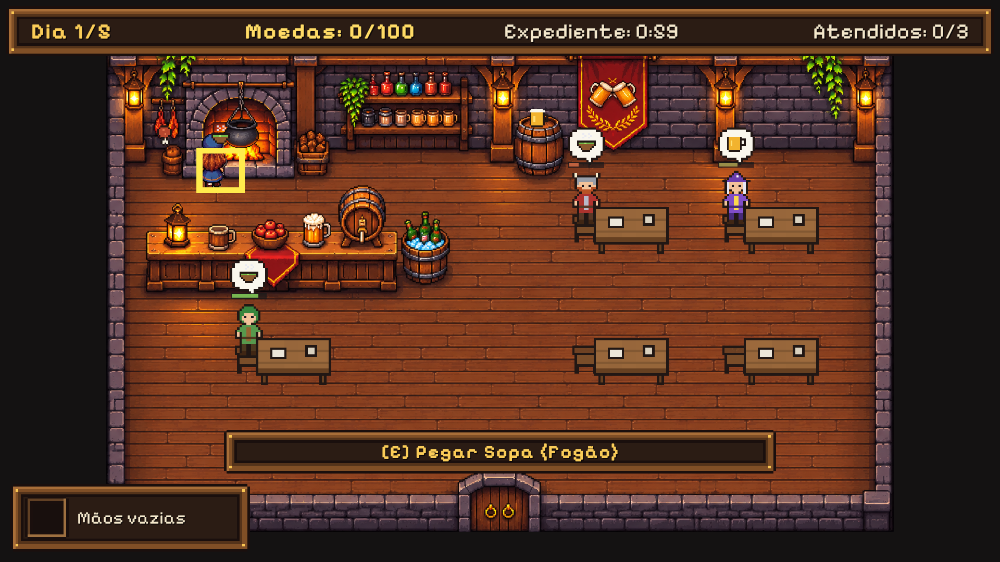

# O Guardião do Farol



Jogo 2D top-down em pixel art, feito na Unity 6. Você é a taverneira da taverna **O Farol**, à beira-mar, e tem **5 dias para juntar 100 moedas** e pagar a dívida da casa antes que o cobrador Valdemar Ferrete a feche. Os clientes são heróis aposentados, cada um com seu pedido, sua paciência e suas histórias.



---

## Como jogar (build pronta)

1. Baixe ou clone este repositório.
2. Abra a pasta `Build/Windows`.
3. Dê dois cliques em **`O Guardiao do Farol.exe`**.

> Requer Windows 10/11 64 bits. Não precisa instalar nada.
> Se o Windows SmartScreen avisar, clique em **Mais informações → Executar assim mesmo** (o executável não é assinado digitalmente).
> Copie a pasta `Build/Windows` **inteira**: o `.exe` não funciona sozinho, ele precisa da pasta `O Guardiao do Farol_Data` e das DLLs ao lado.

### Controles

| Tecla | Ação |
|---|---|
| **W A S D** ou **setas** | Andar |
| **E** ou **Espaço** | Pegar/devolver produto, entregar pedido, avançar diálogo |
| **Enter** | Confirmar botões |
| **Esc** | Fechar diálogo / voltar dos créditos |
| Mouse | Também funciona nos menus |

### Objetivo e regras

- Cada dia tem um **expediente** com tempo limitado. Os heróis entram, sentam numa mesa livre e mostram o pedido num balão.
- Vá até a estação certa, pegue o produto (**você só carrega um item por vez**) e entregue na mesa do cliente.
- Cada cliente tem uma **barra de paciência**: se ela acabar, ele vai embora sem pagar.
- Entregar o item errado não custa nada, mas você perde tempo. O item continua na sua mão.
- No fim de cada dia aparece um resumo. Depois do **5º dia**, com **100 moedas ou mais** você vence. Com menos, a taverna fecha.

| Produto | Onde pegar | Preço |
|---|---|---|
| 🍺 Cerveja | Barril no fundo da taverna | 5 moedas |
| 🥣 Sopa | Caldeirão da lareira | 6 moedas |
| 🍖 Carne | Carne pendurada ao lado da lareira | 8 moedas |

| Dia | Clientes | Expediente | Paciência |
|---|---|---|---|
| 1 | 3 | 100 s | 50 s |
| 2 | 3 | 100 s | 45 s |
| 3 | 5 | 140 s | 40 s |
| 4 | 5 | 140 s | 35 s |
| 5 | 5 | 140 s | 30 s |

**Dica:** são 21 clientes no total, e você precisa atender uns 16. Os dias ficam mais rápidos e os heróis mais impacientes, então planeje o caminho entre a lareira, o barril e as mesas.

---

## Abrindo o projeto na Unity

1. Instale a **Unity 6000.6.8f1** (ou outra Unity 6 compatível) pelo Unity Hub.
2. No Hub: **Add → Add project from disk** e escolha esta pasta (a que contém `Assets`, `Packages` e `ProjectSettings`).
3. Na primeira abertura a Unity recria a pasta `Library` (pode demorar alguns minutos).
4. Aperte **Play**: o editor sempre começa pela tela inicial (`MainMenu`), mesmo se a cena `Game` estiver aberta. Para desligar isso, use o menu **Guardiao do Farol > Play Começa no Menu**.

### Gerar a build novamente

**File → Build Profiles → Windows → Build**, com as cenas `MainMenu` (0) e `Game` (1). Ou pelo menu **Guardiao do Farol > Construir Projeto Completo**, que remonta cenas, arte e áudio antes.

### Ferramentas de editor (menu *Guardiao do Farol*)

| Item | O que faz |
|---|---|
| Construir Projeto Completo | Recria cenas, prefabs, campanha, UI, arte e áudio do zero |
| Gerar e Aplicar Pixel Art | Gera os sprites 16 px (heróis com quadros de caminhada, móveis, ícones) |
| Aplicar Arte Importada | Aplica o fundo da taverna, a arte da tela inicial e as animações da taverneira |
| Aplicar Áudio | Configura e liga músicas e efeitos no `AudioManager` |
| Play Começa no Menu | Liga/desliga o Play pela tela inicial |

---

## Estrutura

```
Assets/_Project/
├── Art/        Generated (pixel art 16 px), Imported (taverna, título, taverneira), UI, Tiles
├── Audio/      Music (menu e taverna) e SFX (13 efeitos)
├── Data/       CampanhaGuardiao.asset (dias, heróis, falas, finais)
├── Fonts/      Pixelify Sans (OFL)
├── Prefabs/    Customer, AudioManager
├── Scenes/     MainMenu, Game
└── Scripts/    Core, Customers, Orders, Economy, Dialogue, Interaction, Player, UI, Audio, Editor
Build/Windows/  Jogo compilado para Windows 64 bits
Screenshots/    Capturas de tela
GUIA_O_Guardiao_do_Farol.md   Guia técnico completo (arquitetura, Inspector, testes)
```

Principais sistemas: `GameManager` (estados e pausa), `DayManager` (expediente e resumo), `CustomerManager`/`CustomerController` (chegada, caminho, paciência), `OrderManager` (pedidos e pagamento), `EconomyManager` (moedas), `DialogueManager` (falas com efeito de máquina de escrever), `UIManager`, `AudioManager` e `CharacterAnimator` (animação por quadros).

Tecnologias: Unity 6, URP 2D, Input System, TextMeshPro, uGUI e Tilemap (usado só para colisão).

---

## Créditos

*O Guardião do Farol* é um jogo desenvolvido para a disciplina de **Desenvolvimento de Jogos Digitais** do professor **Luis Filipe Grael Tinós**.

- **Desenvolvedora:** Marcus Vinícius da Silva Capeteruchi
- **Curso:** Ciência da Computação
- **Instituição:** UNISAGRADO
- **Professor:** Luis Filipe Grael Tinós
- **Disciplina:** Desenvolvimento de Jogos Digitais

**Recursos de terceiros**
- Fonte [Pixelify Sans](https://fonts.google.com/specimen/Pixelify+Sans), © 2021 The Pixelify Sans Project Authors, licença SIL Open Font License 1.1 (`Assets/_Project/Fonts/PixelifySans_OFL.txt`).
- Músicas e efeitos sonoros: sintetizados especialmente para o jogo (chiptune).
